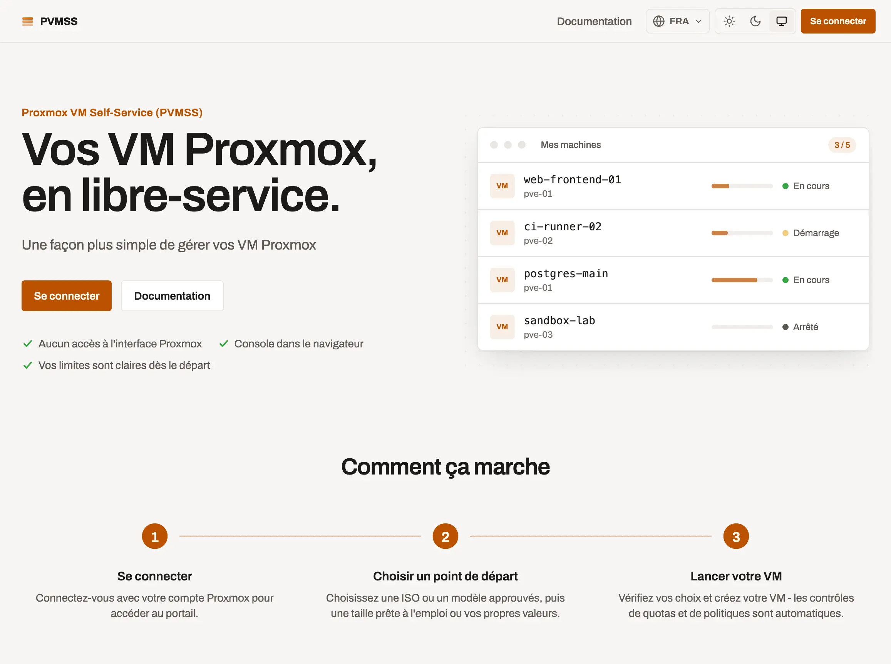
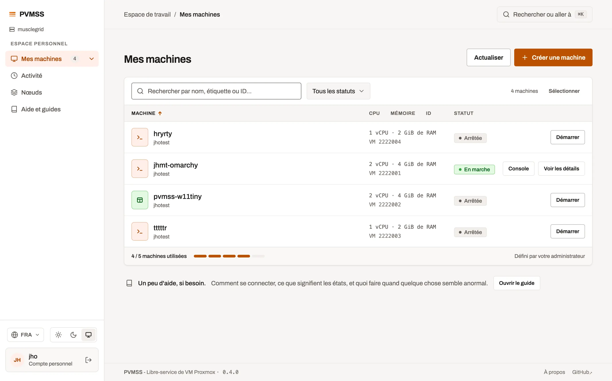

# Proxmox VM Self-Service (PVMSS)

[](https://github.com/julienhmmt/pvmss/actions/workflows/lint.yml) [](https://github.com/julienhmmt/pvmss/actions/workflows/v0.4.yml)

> Un portail libre-service léger pour Proxmox VE : les utilisateurs créent, exploitent et dépannent leurs machines virtuelles sans accès à l'interface Proxmox.

English version: [README.md](README.md)

<!-- markdownlint-disable MD033 -->
<picture>
  <source media="(prefers-color-scheme: dark)" srcset="img/pvmss-v0.4.0-index-dark.webp">
  
</picture>
<!-- markdownlint-enable MD033 -->

## Sommaire

1. [Ce que fait PVMSS](#ce-que-fait-pvmss)
2. [Démarrage rapide](#démarrage-rapide)
3. [Préparer Proxmox](#préparer-proxmox)
4. [Première connexion](#première-connexion)
5. [Les modèles de VM portent les accès](#les-modèles-de-vm-portent-les-accès)
6. [Aller plus loin](#aller-plus-loin)
7. [Venir de la v0.3](#venir-de-la-v03)
8. [Limites connues](#limites-connues)
9. [Licence](#licence)

## Ce que fait PVMSS

PVMSS est une application web (API REST Go + SPA SvelteKit) qui passe par l'API Proxmox pour chaque action sur les VM et garde sa configuration dans SQLite. L'interface est disponible en français, anglais, allemand et italien.

**Pour les utilisateurs**

- Connexion avec ses identifiants Proxmox, puis **Mes VM** : statut en direct, actions d'alimentation groupées, une console sur chaque ligne.
- **Création de VM** depuis une ISO approuvée ou un template Proxmox, avec profils matériels, placement automatique, multi-NIC, UEFI/TPM et tags curés.
- **Exploitation d'une VM** : alimentation, disques, cartes réseau, CPU/RAM, snapshots (manuels et planifiés), duplication, baux, métriques et journal d'activité.
- **Consoles** : noVNC et série dans le navigateur, relayées par PVMSS.

**Pour les administrateurs**

- Plusieurs clusters Proxmox, un catalogue approuvé (nœuds, stockages, ISO, templates, bridges), profils matériels et tags.
- Utilisateurs libre-service (utilisateur Proxmox + pool + ACL en une étape), quotas, plafonds de capacité par nœud, demandes de quota.
- Migration entre nœuds, tableau de bord, journal d'audit, export/import de la base, éditeur de documentation intégrée.

L'inventaire complet, route par route, est dans [docs/FEATURES.md](docs/FEATURES.md) (en anglais).



## Démarrage rapide

Prérequis : Docker, un cluster Proxmox VE 9.x et un jeton d'API (voir [Préparer Proxmox](#préparer-proxmox)).

1. Créez `docker-compose.yml` :

   ```yaml
   services:
     pvmss:
       image: jhmmt/pvmss:0.4.0
       container_name: pvmss
       restart: unless-stopped
       ports:
         - "50000:50000/tcp"
       environment:
         PVMSS_CLUSTER_SOURCE: "proxmox"
         PROXMOX_URL: "https://ip-ou-nom:8006/api2/json"
         PROXMOX_API_TOKEN_NAME: "pvmss-svc@pve!pvmss-service-token"
         PROXMOX_API_TOKEN_VALUE: "aaaaaaaa-0000-44aa-1111-aaaaaaaaaaa"
         # Générer avec : openssl rand -hex 32
         SESSION_SECRET: "remplacer-par-la-sortie-de-openssl-rand-hex-32"
         # Hash bcrypt du mot de passe de "admin" ; chaque "$" doublé pour Compose
         ADMIN_PASSWORD_HASH: "$$2y$$10$$Ppg7Wl3sNYrmxZmWgcq4reOyznt7AeqMrQucaH4HY.dBrzavhPP1e"
         # HTTP simple sans TLS devant : retirer le drapeau Secure des cookies (le garder derrière HTTPS)
         PVMSS_COOKIE_SECURE: "false"
         PVMSS_PORT: "50000"
         LOG_LEVEL: "info"
         LOG_FORMAT: "console"
         LOG_OUTPUT: "stdout"
         TZ: "Europe/Paris"
       volumes:
         - pvmss_data:/data

   volumes:
     pvmss_data: {}
   ```

2. Générez votre propre hash admin et remplacez celui de l'exemple :

   ```bash
   htpasswd -bnBC 10 "" "MotDePasseFort" | tr -d ':\n'
   ```

3. Démarrez puis ouvrez <http://localhost:50000> :

   ```bash
   docker compose up -d
   ```

Vous préférez `docker run` ? Passez les mêmes variables avec `-e` et montez `-v pvmss_data:/data`. Sur Kubernetes, utilisez le chart Helm de [`helm/`](helm/) (`helm install pvmss ./helm -n pvmss --create-namespace -f my-values.yaml`) ; [`helm/values.yaml`](helm/values.yaml) documente chaque valeur.

Persistez tout le répertoire `/data`, pas seulement `pvmss.db` : SQLite tourne en mode WAL et garde des fichiers `-wal`/`-shm` à côté. Chaque variable est décrite dans [docs/configuration.md](docs/configuration.md) (en anglais).

## Préparer Proxmox

Seul Proxmox VE 9.x et plus récent est pris en charge. PVMSS a besoin d'un compte de service avec un jeton d'API, et éventuellement d'un administrateur humain. En _root_ sur un nœud Proxmox :

```bash
# PVMSS_Service : rôle, utilisateur et jeton d'API utilisés par PVMSS
pveum roleadd PVMSS_Service -privs "Sys.Audit VM.Audit VM.Allocate VM.PowerMgmt VM.Console VM.Config.CDROM VM.Config.CPU VM.Config.HWType VM.Config.Memory VM.Config.Disk VM.Config.Network VM.Config.Options VM.Config.Cloudinit VM.Snapshot VM.Snapshot.Rollback VM.Migrate VM.GuestAgent.Audit VM.GuestAgent.Unrestricted Datastore.Audit Datastore.AllocateSpace Datastore.AllocateTemplate Pool.Allocate Pool.Audit User.Modify Permissions.Modify Realm.AllocateUser SDN.Allocate SDN.Audit SDN.Use"

pveum useradd pvmss-svc@pve -comment "PVMSS service account" -enable 1

pveum user token add pvmss-svc@pve pvmss-service-token --privsep 0

pveum aclmod / -user pvmss-svc@pve -role PVMSS_Service -propagate 1

# PVMSS_Admin : administrateur humain optionnel, connecté avec ses identifiants Proxmox
pveum roleadd PVMSS_Admin -privs "Sys.Audit VM.Audit VM.PowerMgmt VM.Console VM.Config.CPU VM.Config.Memory VM.Config.Disk VM.Config.Network VM.Config.HWType VM.GuestAgent.Audit VM.Migrate VM.Config.CDROM VM.Config.Options VM.Config.Cloudinit Datastore.Audit Datastore.AllocateSpace Pool.Allocate Pool.Audit User.Modify Permissions.Modify Realm.AllocateUser SDN.Audit Group.Allocate"

pveum useradd pvmss-admin1@pve -comment "PVMSS administrator <nom>" -password "mot_de_passe_fort" -enable 1

pveum aclmod / -user pvmss-admin1@pve -role PVMSS_Admin -propagate 1
```

Reportez le nom du jeton (`pvmss-svc@pve!pvmss-service-token`) et son secret dans `PROXMOX_API_TOKEN_NAME` / `PROXMOX_API_TOKEN_VALUE`. Les mêmes commandes, expliquées, sont dans la page intégrée `/docs/proxmox-permissions`.

## Première connexion

Sur `/login`, au choix :

- activez l'interrupteur **Administrateur local** et connectez-vous en `admin` avec le mot de passe derrière `ADMIN_PASSWORD_HASH`. Ce compte fonctionne même sans cluster joignable, et lui seul crée d'autres administrateurs locaux (**Admin > Paramètres > Comptes**) ;
- ou connectez-vous avec un compte Proxmox détenant `Permissions.Modify` sur `/` (rôle `Administrator` ou `PVMSS_Admin` ; le rôle intégré `PVEAdmin` ne l'a pas), realm `pve` ou `pam`.

Ensuite, depuis l'espace Admin : approuvez nœuds, stockages, ISO, templates et bridges, créez des profils matériels, puis votre premier utilisateur libre-service. Récupération de mot de passe et règles des comptes : [docs/configuration.md](docs/configuration.md).

## Les modèles de VM portent les accès

PVMSS n'ajoute ni clé SSH ni mot de passe aux VM qu'il crée (l'écriture cloud-init a été supprimée, voir [docs/cloud-init.md](docs/cloud-init.md)). Un clone garde exactement ce que porte son template Proxmox : préparez chaque template approuvé avec les accès dont les utilisateurs ont besoin.

1. Dans l'onglet **Cloud-Init** du template dans Proxmox, définissez l'utilisateur et une clé SSH publique ou un mot de passe (ou intégrez un compte à l'image).
2. Installez et activez `qemu-guest-agent`, pour que les VM remontent leur adresse.
3. Convertissez-le (`qm template <vmid>`) et approuvez-le dans **Admin > Modèles de VM**.

Les installations depuis une ISO ne sont pas concernées : l'utilisateur crée son compte pendant l'installation, depuis la console du navigateur.

## Aller plus loin

| Sujet                                                             | Où (en anglais)                                |
| ----------------------------------------------------------------- | ---------------------------------------------- |
| Toutes les variables d'environnement, comptes admin, récupération | [docs/configuration.md](docs/configuration.md) |
| Journaux, JSON et syslog SIEM, métriques Prometheus, traces       | [docs/observability.md](docs/observability.md) |
| HTTPS, TLS mutuel, reverse proxies, WebSockets des consoles       | [docs/tls.md](docs/tls.md)                     |
| Chaque fonctionnalité, route par route                            | [docs/FEATURES.md](docs/FEATURES.md)           |
| Stack de développement, tests, contribuer                         | [CONTRIBUTING.md](CONTRIBUTING.md)             |

**Mises à jour en v0.4.x** : tirez le nouveau tag d'image et redémarrez ; la configuration reste dans la base. Les pages de documentation intégrée sont créées une fois et jamais écrasées : vos modifications survivent aux mises à jour.

**Derrière un reverse proxy** : les consoles de VM sont des WebSockets. Chaque saut doit relayer l'upgrade WebSocket et garder les connexions inactives ouvertes pendant toute une session console. Une console noire ou une erreur `1006` signifie que le WebSocket n'a jamais atteint PVMSS ; des recettes HAProxy, nginx, Caddy, Traefik et Kubernetes sont dans [docs/tls.md](docs/tls.md).

## Venir de la v0.3

Il n'y a pas de migration : la v0.4 est une réécriture et n'importe rien de la v0.3. Déployez-la comme une nouvelle installation sur une nouvelle base, puis reconfigurez-la depuis l'interface Admin. Vos VM restent dans Proxmox.

- Nouvelles variables obligatoires : `PVMSS_PORT`, `PVMSS_CLUSTER_SOURCE`, `LOG_LEVEL` (minuscules uniquement), `LOG_FORMAT`, `LOG_OUTPUT`.
- `PROXMOX_URL` et `PROXMOX_API_TOKEN_*` ne créent que le premier cluster ; ensuite **Admin > Clusters** les gère.
- Les variables supprimées sont listées dans [docs/configuration.md](docs/configuration.md).
- Les pools et utilisateurs Proxmox d'une installation précédente se connectent toujours, mais **Admin > Utilisateurs PVMSS** ne liste que ceux créés par cette base.

## Limites connues

- Seul Proxmox VE 9.x et plus récent est pris en charge.
- Le durcissement de la sécurité se poursuit ; pas encore de test d'intrusion formel.
- Pas de VM gérées par HA, pas de migration entre clusters ; SDN et règles de pare-feu restent dans Proxmox.
- Les realms OIDC de Proxmox ne peuvent pas se connecter (seuls `pve` et `pam`) ; les administrateurs locaux PVMSS restent disponibles.

Retours et contributions bienvenus via issues ou pull requests. Prochaines versions : <https://github.com/julienhmmt/pvmss/projects?query=is%3Aopen>.

## Licence

PVMSS par Julien HOMMET est sous licence **GNU AGPL v3**. Voir <https://www.gnu.org/licenses/agpl-3.0.fr.html>.
