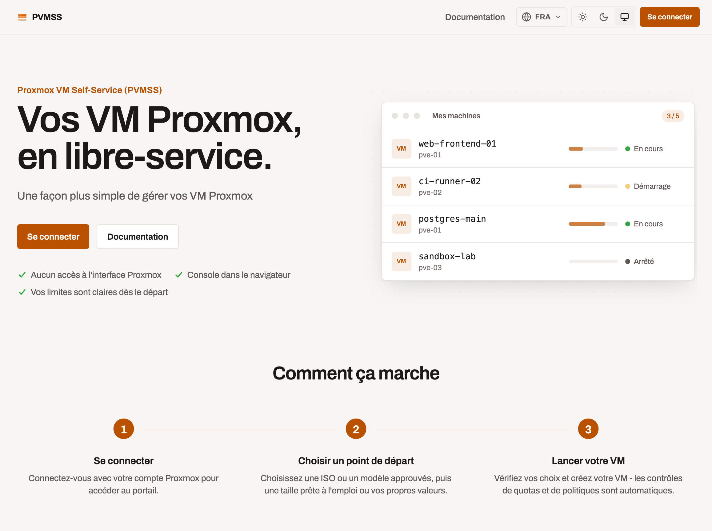
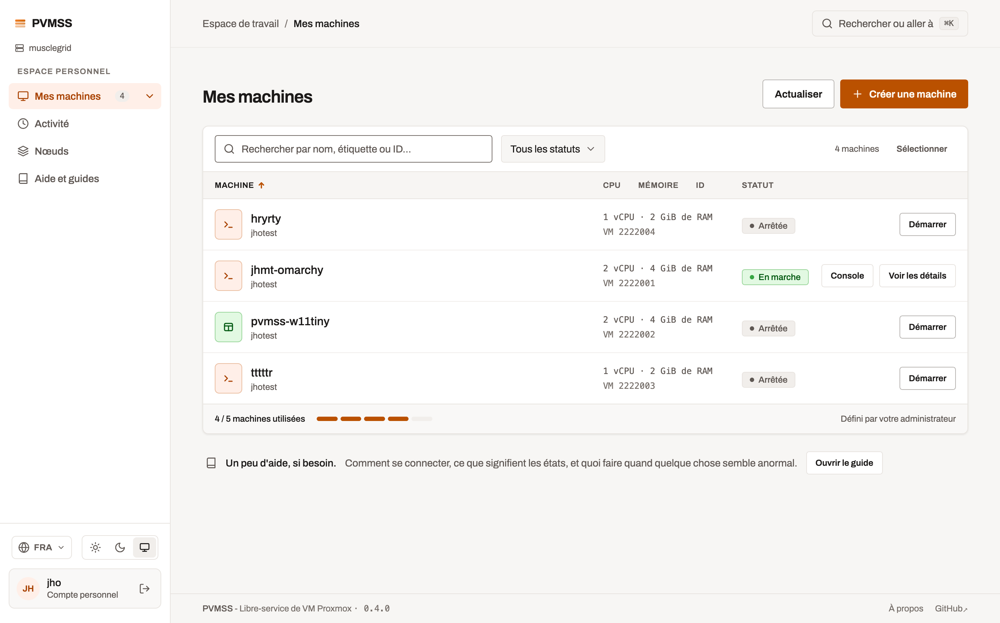
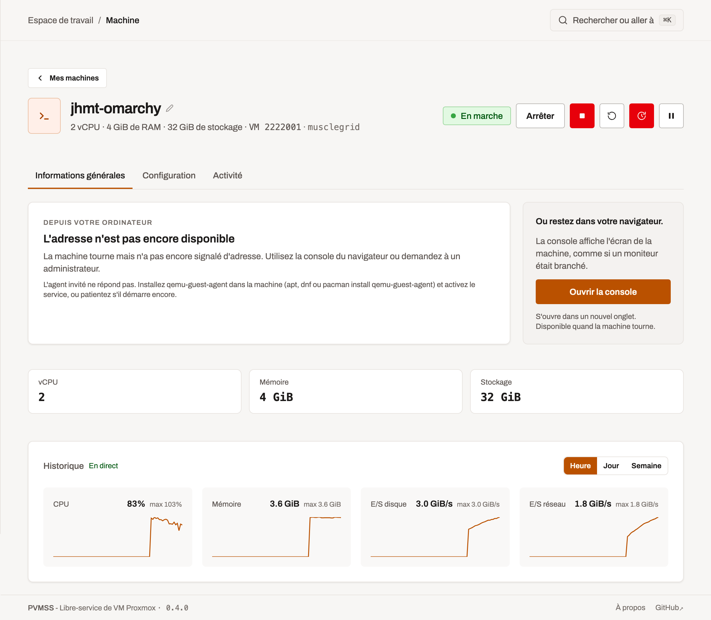
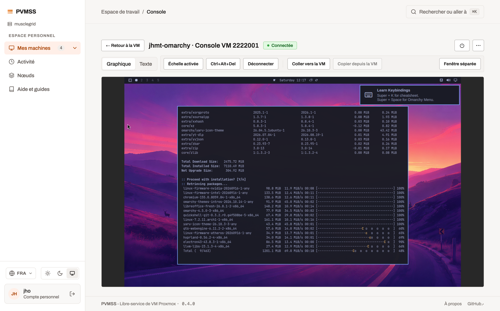
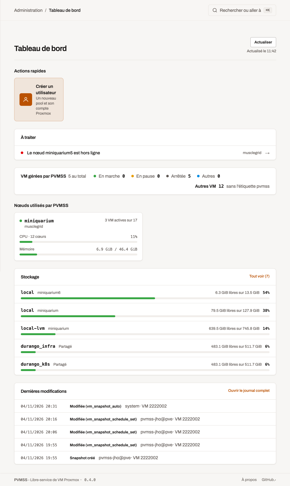

# Proxmox VM Self-Service (PVMSS)

[](https://github.com/julienhmmt/pvmss/actions/workflows/lint.yml) [](https://github.com/julienhmmt/pvmss/actions/workflows/v0.4.yml)

> Portail web léger pour Proxmox VE qui permet de créer, exploiter et dépanner des machines virtuelles sans exposer l'interface Proxmox.

Version anglaise : [README.md](README.md)

<!-- markdownlint-disable MD033 -->
<picture>
  <source media="(prefers-color-scheme: dark)" srcset="img/pvmss-v0.4.0-index-dark.png">
  
</picture>
<!-- markdownlint-enable MD033 -->

*L'interface est disponible en français, anglais, allemand et italien. Les captures ci-dessous présentent l'interface française.*

---

## Sommaire

1. [Vue d'ensemble](#vue-densemble)
2. [Fonctionnalités](#fonctionnalités)
3. [Architecture en un coup d'œil](#architecture-en-un-coup-dœil)
4. [Configuration](#configuration)
5. [Options de déploiement](#options-de-déploiement)
6. [Démarrage rapide avec Docker run](#démarrage-rapide-avec-docker-run)
7. [Démarrer avec Docker compose](#démarrer-avec-docker-compose)
8. [Démarrer avec Kubernetes](#démarrer-avec-kubernetes)
9. [Derrière un reverse proxy](#derrière-un-reverse-proxy)
10. [Venir de la v0.3](#venir-de-la-v03)
11. [Exploitation](#exploitation)
12. [Limites connues](#limites-connues)
13. [Licence](#licence)

---

## Vue d'ensemble

PVMSS est une application web (API REST Go + SPA SvelteKit) qui s'appuie sur les API Proxmox pour toutes les actions sur les VM et garde sa configuration dans SQLite. Elle propose des sessions par utilisateur, une image conteneur prête à l'emploi, des limites de ressources configurables, une sélection de stockage compatible cluster, des formulaires guidés et une documentation intégrée.

> ⚠️ Le projet reste en développement actif. Consultez la section [Limites connues](#limites-connues) avant un déploiement en production.

## Fonctionnalités

L'inventaire complet, route par route, est dans [docs/FEATURES.md](docs/FEATURES.md) (en anglais).

### Utilisateurs finaux

- Connexion avec ses identifiants Proxmox sur le cluster de son choix.
- **Mes VM** : liste des VM du cluster de connexion, recherche/filtre/tri reflétés dans l'URL, statut en direct, actions d'alimentation groupées avec résultat par VM, bouton console sur chaque ligne.
- **Assistant de création** (mode Simple / Détaillé) depuis deux sources : une **ISO** approuvée ou un **template** Proxmox (clone lié ou complet). Profils matériels ou valeurs libres, placement automatique avec score de capacité, multi-NIC (bridge + modèle), UEFI (sans Secure Boot) / TPM 2.0, tags curés, démarrage sur CD-ROM.
- **Accès aux VM** : PVMSS n'ajoute ni clé SSH ni mot de passe (l'écriture cloud-init a été supprimée). Un clone de template garde les accès intégrés à son template Proxmox ; une installation ISO reçoit le compte créé par l'utilisateur pendant l'installation. Voir [Les modèles de VM portent les accès](#les-modèles-de-vm-portent-les-accès).
- **Exploitation d'une VM** : 7 actions d'alimentation, renommage, description Markdown, suppression ; disques (ajout / agrandissement / détachement) ; cartes réseau (bridge, modèle, VLAN, débit) ; CPU/RAM/tags/CD-ROM ; snapshots (création / restauration / suppression, RAM optionnelle) plus une planification automatique quotidienne/hebdomadaire avec rétention ; duplication d'une VM en clone complet ; expiration et prolongation du bail quand le cluster active les baux ; historique de métriques (heure/jour/semaine) et flux temps réel ; journal d'activité par VM.
- **Consoles** : noVNC et série (xterm.js), toutes deux relayées par PVMSS avec ticket à usage unique ; actions d'alimentation depuis la console.
- Page Nœuds avec capacité en direct, documentation intégrée (FR + EN), interface en FR, EN, DE et IT, navigation clavier, cible WCAG 2.1 AA.



*Mes VM : statut en direct, ressources, quotas et actions d'alimentation.*



*Vue d'ensemble d'une VM : actions d'alimentation, configuration et métriques en direct.*



*Console navigateur : accès graphique et série sans exposer l'interface Proxmox.*

### Administrateurs

- **Clusters** : connexion à plusieurs environnements Proxmox, test de connectivité, renommage de l'identifiant d'un cluster (toutes les lignes concernées suivent) ; adoption des pools et tags qu'une installation PVMSS précédente a laissés sur un cluster depuis **Admin > Récupération**.
- **Catalogue** : approbation des nœuds, stockages, ISO, templates de VM, bridges ; CRUD des profils matériels et des tags ; approbations obsolètes réconciliées avec la découverte en direct.
- **Pools** : création d'un utilisateur self-service = utilisateur Proxmox + pool + ACL en une étape ; suppression en cascade.
- **Migration** : déplacement d'une VM gérée par PVMSS vers un autre nœud approuvé et en ligne du même cluster depuis la page du nœud (contrôle préalable, confirmation explicite, progression dans le tiroir des tâches).
- **Politique** : gabarit par cluster (sockets, cœurs, mémoire, disque par VM, NIC, snapshots, VLAN d'isolation) et quota (VM par pool) ; surcharges de quota par pool ; plafonds de capacité par nœud avec usage en direct. Les demandes d'augmentation de quota arrivent dans les alertes du tableau de bord et un compteur de la barre latérale ; en approuver une écrit une surcharge pour le pool du demandeur, jamais le plafond du cluster.
- **Système** : tableau de bord, informations applicatives, journal d'audit avec rétention + aperçu de purge, export SQLite et import en deux temps, CMS de documentation intégrée (FR/EN, par audience).



*Tableau de bord administrateur : capacité, activité récente, migrations en attente et demandes de quota.*

## Architecture en un coup d'œil

- **Serveur** (`server/`) : Go 1.27, routage `net/http` de la stdlib, SQLite via `modernc.org/sqlite` (sans CGO). Sert `/api/v1/*` et le SPA.
- **Web** (`web/`) : SPA SvelteKit (Svelte 5 runes, TypeScript, Tailwind CSS v4, `adapter-static`).
- **Authentification** : token API Proxmox pour les actions cluster, sessions utilisateur pour l'UI.

## Configuration

### Roles et permissions (obligatoire)

PVMSS utilise des rôles et des ACLs Proxmox pour fonctionner correctement (compte service, comptes admin, pools utilisateurs).

Avant d'utiliser PVMSS en production, vous **devez**:

- Créer les rôles `PVMSS_Service` et `PVMSS_Admin` avec les privilèges attendus.
- Créer les utilisateurs Proxmox correspondants, le token API et les ACL.

Les commandes `pveum` exactes et les privilèges requis sont documentés dans:

- La page d'admin intégrée `/docs/proxmox-permissions` (une fois PVMSS démarré)

Vous pouvez créer les rôles et les ACLs en utilisant le `pveum` en ligne de commande. Vous pouvez également les créer en utilisant l'interface web de Proxmox. En tant qu'utilisateur _root_, créez les rôles et les privilèges suivants :

```bash
# PVMSS_Service
pveum roleadd PVMSS_Service -privs "Sys.Audit VM.Audit VM.Allocate VM.PowerMgmt VM.Console VM.Config.CPU VM.Config.Memory VM.Config.Disk VM.Config.Network VM.Config.Options VM.Config.Cloudinit VM.Snapshot VM.Snapshot.Rollback VM.Migrate VM.GuestAgent.Audit VM.GuestAgent.Unrestricted Datastore.Audit Datastore.AllocateSpace Datastore.AllocateTemplate Pool.Allocate Pool.Audit User.Modify Permissions.Modify Realm.AllocateUser SDN.Allocate SDN.Audit SDN.Use"

pveum useradd pvmss-svc@pve -comment "PVMSS service account" \
  -enable 1

pveum user token add pvmss-svc@pve pvmss-service-token --privsep 0

# PVMSS_Admin
pveum roleadd PVMSS_Admin -privs "Sys.Audit VM.Audit VM.PowerMgmt VM.Console VM.Config.CPU VM.Config.Memory VM.Config.Disk VM.Config.Network VM.Config.HWType VM.GuestAgent.Audit VM.Migrate VM.Config.CDROM VM.Config.Options VM.Config.Cloudinit Datastore.Audit Datastore.AllocateSpace Pool.Allocate Pool.Audit User.Modify Permissions.Modify Realm.AllocateUser SDN.Audit Group.Allocate"

pveum useradd pvmss-admin1@pve \
  -comment "PVMSS administrator <name>" -password "strong_password" \
  -enable 1

pveum aclmod / -user pvmss-admin1@pve -role PVMSS_Admin -propagate 1
```

Les commandes `pveum` et les informations relatives aux rôles et aux privilèges requis sont détaillées dans :

- La page d'admin intégrée `/docs/proxmox-permissions` (une fois PVMSS démarré et vous êtes connecté en tant qu'administrateur)

### Connexion administrateur

PVMSS accepte deux types d'administrateur, qui aboutissent tous deux à la même interface d'administration :

- **Administrateur Proxmox** - connectez-vous sur `/login` avec un compte Proxmox dont l'ACL accorde `Permissions.Modify` sur `/` (le rôle intégré `PVEAdmin` ou `Administrator`, ou un rôle personnalisé portant ce privilège). Choisissez le realm `pve` (Proxmox VE) ou `pam` (Linux PAM) ; saisir explicitement `user@realm` l'emporte sur le sélecteur. Le drapeau admin est lu à la connexion et conservé pour la session (24 h maximum) : une permission accordée plus tard demande une nouvelle connexion. Les realms OIDC ne sont pas encore pris en charge.
- **Administrateur local** - indépendant de Proxmox ; connexion depuis la même page avec l'interrupteur « Administrateur local ». `ADMIN_PASSWORD_HASH` initialise le compte d'amorçage (`admin`), seul propriétaire autorisé à créer d'autres comptes sous **Admin > Paramètres > Comptes**. Ces comptes en base sont plafonnés par `PVMSS_MAX_LOCAL_ADMINS`, leurs mots de passe font 8 caractères minimum (72 octets maximum, la limite bcrypt), et peuvent être réinitialisés, désactivés et supprimés ; chacune de ces actions révoque les sessions du compte. Cinq échecs de connexion consécutifs verrouillent un compte pendant 15 minutes.

Si un administrateur local perd son mot de passe : les comptes en base sont réinitialisés par le propriétaire depuis **Admin > Paramètres > Comptes** (la réinitialisation lève aussi le verrou et révoque les sessions du compte). Le compte `admin` d'amorçage, lui, se change en remplaçant `ADMIN_PASSWORD_HASH` par un nouveau hash bcrypt puis en redémarrant. Si le propriétaire créé par le setup - le seul propriétaire tant qu'`ADMIN_PASSWORD_HASH` n'est pas défini, protégé contre la suppression et la désactivation - perd l'accès, définissez `ADMIN_PASSWORD_HASH` et redémarrez : `admin` redevient propriétaire et peut réinitialiser ou recréer le compte verrouillé.

### Créer un token API pour l'utilisateur root@pam

Si vous souhaitez utiliser PVMSS en développement, vous **devez** créer un token API pour l'utilisateur `root@pam`. C'est la manière la plus simple de commencer, mais gardez à l'esprit que c'est la moins sécurisée.

Allez dans Datacenter > Permissions > API Tokens. Cliquez sur le bouton “Add” et sélectionnez l'utilisateur `root@pam`. Tapez le nom du token API, décochez la case "Privilege Separations", et récupérez le secret (sera visible une seule fois).

Vous pouvez maintenant utiliser le token API dans les variables d'environnement `PROXMOX_API_TOKEN_NAME` et `PROXMOX_API_TOKEN_VALUE`.

### Configuration de la base de données

PVMSS utilise une base de données SQLite intégrée pour stocker toute la configuration. La base de données est initialisée automatiquement au premier démarrage et inclut :

- Les nœuds, stockages, VMBR et dépôts ISO approuvés
- Les limites de ressources VM (globales, par nœud et surcharges de quota par pool)
- Les tags et pools utilisateurs
- Les profils VM, les connexions aux clusters, les demandes de quota, le journal d'audit

Toute la configuration est gérée via la section **Admin** de l'interface web, qui fournit :

- Opérations CRUD complètes pour tous les éléments de configuration
- Historique d'audit de tous les changements
- Fonctionnalités d'import/export pour sauvegarde/restauration

Persistez tout le répertoire `/data` (un volume), pas le seul fichier `pvmss.db` : SQLite fonctionne en mode WAL et garde des fichiers `-wal`/`-shm` à côté. Pour une sauvegarde, utilisez **Admin > Paramètres > Exporter la base de données**.

#### Tags

Le tag `pvmss` est utilisé par défaut pour les VMs créées via PVMSS, il ne peut pas et ne doit pas être supprimé. Seul les tags créés par l'admin via PVMSS peuvent être utilisés.

#### Profils de VM

Les profils de VM sont des gabarits matériels (sockets, cœurs, mémoire, disque,
bus de disque) que les administrateurs gèrent dans **Admin > Profils**. Les
utilisateurs choisissent un profil dans l'assistant de création au lieu de
saisir les valeurs CPU/RAM/disque. PVMSS ne livre aucun profil par défaut :
créez ceux dont vos utilisateurs ont besoin. Chaque profil a un libellé, les
valeurs ci-dessus, une description optionnelle en Markdown limité et un
indicateur d'activation (seuls les profils activés sont proposés). Les limites
par cluster (gabarit) d'**Admin > Politique** plafonnent toujours chaque
valeur.

### Les modèles de VM portent les accès

PVMSS n'ajoute ni clé SSH ni mot de passe aux VM qu'il crée : l'écriture
cloud-init a été supprimée le 2026-10-31 (voir
[docs/cloud-init.md](docs/cloud-init.md)). Un clone garde exactement ce que
porte son modèle Proxmox : préparez donc chaque modèle approuvé avec les
accès nécessaires :

1. Dans l'onglet **Cloud-Init** du modèle dans Proxmox, renseignez
   l'utilisateur et une clé SSH publique ou un mot de passe (ou intégrez un
   compte dans l'image).
2. Installez et activez `qemu-guest-agent`, pour que les VM signalent leur
   adresse et que l'onglet **Informations générales** affiche la commande SSH.
3. Convertissez-le (`qm template <vmid>`) et approuvez-le dans **Admin >
   Modèles de VM**.

Toutes les VM clonées d'un même modèle partagent ces accès : transmettez-les
aux utilisateurs de ce modèle, ou gardez un modèle par équipe. Les
installations ISO ne sont pas concernées : l'utilisateur crée son propre
compte pendant l'installation, depuis la console du navigateur.

### Cloud-init (supprimé)

L'écriture cloud-init a été supprimée le 2026-10-31 : plus de modèles
cloud-init, plus d'écriture d'utilisateur/mot de passe/clé SSH par VM, plus
d'import d'images cloud, plus de stockage de snippets. Il reste l'endpoint en
lecture seule `GET /api/v1/vms/{cluster}/{vmid}/cloudinit` (utilisateur SSH
pour l'aide à la connexion). Les fichiers `pvmss-*.yml` qu'une ancienne version
aurait laissés sur les nœuds ne sont plus suivis - supprimez-les à la main.
Détails et notes de migration : [docs/cloud-init.md](docs/cloud-init.md).

### Variables d'environnement

Utilisez **soit** un `.env` (via `env_file`) **soit** des variables inline, pas les deux. Variables essentielles :

| Variable                                                   | Description                                                                                                                          | Requis                | Valeur par défaut  |
| ---------------------------------------------------------- | ------------------------------------------------------------------------------------------------------------------------------------ | --------------------- | ------------------ |
| `PVMSS_PORT`                                               | Port TCP d'écoute du serveur HTTP (1–65535)                                                                                          | ✅                    | -                  |
| `PVMSS_DB_PATH`                                            | Chemin vers le fichier SQLite (volume persistant requis)                                                                             | ✅                    | -                  |
| `SESSION_SECRET`                                           | Secret de 32+ octets pour sessions/cookies                                                                                           | ✅                    | -                  |
| `PVMSS_CLUSTER_SOURCE`                                     | `proxmox` pour un vrai cluster, `fake` pour la démo (aucun défaut, exprès)                                                           | ✅                    | -                  |
| `LOG_LEVEL`                                                | `debug`, `info`, `warn`, `error` - minuscules uniquement                                                                             | ✅                    | -                  |
| `LOG_FORMAT`                                               | `console` (lisible humainment) ou `json` (pour SIEM/collecte)                                                                        | ✅                    | -                  |
| `LOG_OUTPUT`                                               | `stdout`, `stderr`, ou un chemin de fichier accessible en écriture                                                                   | ✅                    | -                  |
| `PVMSS_SYSLOG_ADDR`                                        | `host:port` d'un récepteur syslog SIEM (RFC 5425 sur TLS, en général 6514). Vide = désactivé                                         | ❌                    | vide               |
| `PVMSS_SYSLOG_TLS_CA_FILE`                                 | Certificat CA PEM ayant signé le certificat du récepteur ; vide = racines système. La vérification reste active                      | ❌                    | racines système    |
| `PVMSS_SYSLOG_TLS_CERT_FILE` / `PVMSS_SYSLOG_TLS_KEY_FILE` | Certificat et clé client pour le mTLS (les deux) ; voir [docs/observability.md](docs/observability.md)                               | ❌                    | vide               |
| `PROXMOX_URL`                                              | URL complète de l'API (`https://host:8006/api2/json`)                                                                                | si source = `proxmox` | -                  |
| `PROXMOX_API_TOKEN_NAME`                                   | Nom du token Proxmox (`user@pve!token`)                                                                                              | si source = `proxmox` | -                  |
| `PROXMOX_API_TOKEN_VALUE`                                  | Valeur du token ci-dessus                                                                                                            | si source = `proxmox` | -                  |
| `ADMIN_PASSWORD_HASH`                                      | Hash bcrypt de l'admin local ; désactivé si vide                                                                                     | ❌                    | -                  |
| `PVMSS_HOST`                                               | Adresse d'écoute (`0.0.0.0` pour toutes les interfaces)                                                                              | ❌                    | `127.0.0.1`        |
| `PVMSS_WEB_DIR`                                            | Répertoire contenant le SPA compilé                                                                                                  | ❌                    | relatif au binaire |
| `PVMSS_COOKIE_SECURE`                                      | Drapeau `Secure` sur les cookies d'auth (garder `true` en production)                                                                | ❌                    | `true`             |
| `PVMSS_INVENTORY_REFRESH_INTERVAL`                         | Période de rafraîchissement de l'inventaire                                                                                          | ❌                    | `30s`              |
| `PVMSS_INVENTORY_MANUAL_REFRESH_MIN_INTERVAL`              | Délai minimum entre deux rafraîchissements manuels                                                                                   | ❌                    | `5s`               |
| `PVMSS_INVENTORY_REFRESH_TIMEOUT`                          | Timeout d'un rafraîchissement d'inventaire                                                                                           | ❌                    | `15s`              |
| `PVMSS_MAX_LIST_PAGE_SIZE`                                 | Taille de page maximale des endpoints de liste                                                                                       | ❌                    | `100`              |
| `PVMSS_MAX_LOCAL_ADMINS`                                   | Nombre maximum d'administrateurs locaux en base (1-50 ; hors admin d'amorçage)                                                       | ❌                    | `5`                |
| `PVMSS_TRUSTED_PROXY_HOPS`                                 | Nombre de reverse proxies devant PVMSS (IP client / limitation de débit) ; à régler derrière un proxy (Helm : `1`)                   | ❌                    | `0`                |
| `PVMSS_RATE_LIMIT_MAX`                                     | Relève tous les plafonds de limitation de débit intégrés (auth par IP, écritures par utilisateur) ; `0` garde les valeurs par défaut | ❌                    | `0`                |
| `PVMSS_DB_RESET_ON_INCOMPATIBLE`                           | Sur une base incompatible, la renomme et repart à zéro au lieu de refuser le démarrage (commodité de dev)                            | ❌                    | `false`            |
| `PVMSS_METRICS_PORT`                                       | Port de l'écouteur `GET /metrics` sur `PVMSS_HOST` (1-65535, différent de `PVMSS_PORT`) ; vide = désactivé                           | ❌                    | vide               |
| `PVMSS_TLS_CERT_FILE` / `PVMSS_TLS_KEY_FILE`               | Sert du HTTPS avec ce certificat et cette clé PEM (les deux) ; voir [docs/tls.md](docs/tls.md)                                       | ❌                    | vide (HTTP clair)  |
| `PVMSS_TLS_CLIENT_CA_FILE`                                 | Bundle CA PEM pour les certificats clients : active le TLS mutuel (**recommandé**)                                                   | ❌                    | vide               |
| `PVMSS_TLS_CLIENT_AUTH`                                    | Certificat client `require` ou `optional` (nécessite `PVMSS_TLS_CLIENT_CA_FILE`)                                                     | ❌                    | `require`          |
| `TZ`                                                       | Fuseau horaire du conteneur                                                                                                          | ❌                    | `UTC`              |

L'image Docker prérègle `PVMSS_DB_PATH=/data/pvmss.db`, `PVMSS_HOST=0.0.0.0` et
`PVMSS_WEB_DIR=/app/web/build` : ces trois-là peuvent rester vides en conteneur.

> Astuce : générez `ADMIN_PASSWORD_HASH` avec `htpasswd -bnBC 10 "" "MotDePasseFort" | tr -d ':\n'`. Dans un fichier Compose (ou un `.env` lu par Compose), doublez chaque `$` en `$$`.

#### Configuration des logs

PVMSS utilise des logs structurés basés sur `log/slog` de la bibliothèque
standard. Les trois variables sont obligatoires ; `LOG_LEVEL` est comparé en
tenant compte de la casse et n'accepte que des minuscules. `LOG_OUTPUT` accepte
`stdout`, `stderr` ou un chemin de fichier - il n'y a pas de mode « both ».

- Logs lisibles en développement :

  ```bash
  LOG_LEVEL=debug
  LOG_OUTPUT=stdout
  LOG_FORMAT=console
  ```

- Logs JSON sur stdout pour un collecteur de logs :

  ```bash
  LOG_LEVEL=info
  LOG_OUTPUT=stdout
  LOG_FORMAT=json
  ```

- Logs JSON dans un fichier à l'intérieur du conteneur :

  ```bash
  LOG_LEVEL=info
  LOG_OUTPUT=/app/pvmss.log
  LOG_FORMAT=json
  ```

Le format JSON est une ligne par événement, avec un champ `component` (main, cluster, inventory, ...). Cela facilite l'ingestion par Fluent Bit, Filebeat ou un SIEM.

Pour un SIEM qui accepte directement le syslog, renseignez `PVMSS_SYSLOG_ADDR` : les mêmes enregistrements partent en RFC 5424 sur TLS, voir [docs/observability.md](docs/observability.md).

## Options de déploiement

| Plateforme          | Détails                                                                                                 |
| ------------------- | ------------------------------------------------------------------------------------------------------- |
| **Docker / Podman** | Idéal pour tester ou déployer sur un seul hôte. Montez le volume de base de données et exposez `50000`. |
| **Docker Compose**  | Expérience recommandée : service unique, variables centralisées, environnement reproductible.           |
| **Kubernetes**      | Utilisez le chart Helm dans [`helm/`](helm/) : `helm install pvmss ./helm -f mes-values.yaml`.          |

## Démarrage rapide avec Docker run

```bash
docker run -d \
  --name pvmss \
  --restart unless-stopped \
  -p 50000:50000 \
  -v pvmss_data:/data \
  -e ADMIN_PASSWORD_HASH='$2y$10$Ppg7Wl3sNYrmxZmWgcq4reOyznt7AeqMrQucaH4HY.dBrzavhPP1e' \
  -e LOG_LEVEL=info \
  -e LOG_OUTPUT=stdout \
  -e LOG_FORMAT=console \
  -e PROXMOX_API_TOKEN_NAME='tokenName@changeMe!value' \
  -e PROXMOX_API_TOKEN_VALUE="aaaaaaaa-0000-44aa-1111-aaaaaaaaaaa" \
  -e PROXMOX_URL=https://ip-or-name:8006/api2/json \
  -e PVMSS_CLUSTER_SOURCE=proxmox \
  -e PVMSS_PORT=50000 \
  -e PVMSS_DB_PATH="/data/pvmss.db" \
  -e SESSION_SECRET="$(openssl rand -hex 32)" \
  -e TZ=Europe/Paris \
  jhmmt/pvmss:0.4
```

Pour écrire les logs JSON dans un fichier à l'intérieur du conteneur au lieu de stdout, surchargez :

```bash
-e LOG_FORMAT=json \
-e LOG_OUTPUT=/app/pvmss.log \
-v $(pwd)/pvmss.log:/app/pvmss.log \
```

L'application sera accessible sur <http://localhost:50000>. En HTTP en clair sur autre chose que `localhost`, ajoutez `-e PVMSS_COOKIE_SECURE=false` (gardez la valeur par défaut derrière HTTPS).

## Démarrer avec Docker compose

1. **Créer `docker-compose.yml` :**

```yaml
services:
  pvmss:
    image: jhmmt/pvmss:0.4
    container_name: pvmss
    restart: unless-stopped
    ports:
      - "50000:50000/tcp"
    environment:
      PROXMOX_API_TOKEN_NAME: "tokenName@changeMe!value"
      PROXMOX_API_TOKEN_VALUE: "aaaaaaaa-0000-44aa-1111-aaaaaaaaaaa"
      PROXMOX_URL: "https://ip-or-name:8006/api2/json"
      PVMSS_CLUSTER_SOURCE: "proxmox"
      # Chaque « $ » du hash bcrypt est doublé pour Compose
      ADMIN_PASSWORD_HASH: "$$2y$$10$$Ppg7Wl3sNYrmxZmWgcq4reOyznt7AeqMrQucaH4HY.dBrzavhPP1e"
      # HTTP en clair sans TLS devant : retirer le drapeau Secure (à garder derrière HTTPS)
      PVMSS_COOKIE_SECURE: "false"
      LOG_LEVEL: "info" # "debug", "info", "warn", "error"
      LOG_OUTPUT: "stdout" # "stdout", "stderr", ou un chemin de fichier
      LOG_FORMAT: "console" # "console", "json"
      SESSION_SECRET: "changeMeWithSomethingElseUniqueMinimum32Chars"
      PVMSS_PORT: "50000"
      PVMSS_DB_PATH: "/data/pvmss.db"
      TZ: "Europe/Paris"
    volumes:
      - pvmss_data:/data
      # - ./pvmss.log:/app/pvmss.log # Décommentez pour persister les logs dans un fichier à l'intérieur du conteneur
    deploy:
      resources:
        limits:
          cpus: "1"
          memory: 128M

volumes:
  pvmss_data: {}
```

Pour persister les logs dans un fichier à l'intérieur du conteneur, vous pouvez ajuster la section `environment` :

```yaml
LOG_FORMAT: "json"
LOG_OUTPUT: "/app/pvmss.log"
# Ajoutez ce volume à la section volumes
- ./pvmss.log:/app/pvmss.log
```

1. **Démarrer la stack :**

   ```bash
   docker compose up -d
   ```

2. Ouvrez un navigateur et accédez à **<http://localhost:50000>**.
3. Se connecter avec le compte admin, sur la page "Login", cliquez sur "Connexion administrateur".

## Démarrer avec Kubernetes

Un chart Helm est fourni dans [`helm/`](helm/) : `helm install pvmss ./helm -f mes-values.yaml`.
`values.yaml` documente chaque variable.

**Secrets en GitOps (ArgoCD, Flux).** Le hash bcrypt admin contient des `$` (`$2y$10$...`), que les paramètres ArgoCD, les shells et `envsubst` suppriment ou expandent. Deux options sûres :

- Apportez votre propre Secret (SealedSecrets, External Secrets, SOPS) avec les clés `admin-password-hash` (optionnel), `pve-api-token` et `session-secret`, puis réglez `secrets.existingSecret`.
- Ou passez le hash encodé en base64, qui n'a pas de `$` :

```bash
htpasswd -bnBC 10 "" 'MotDePasseFort' | tr -d ':\n' | base64
```

puis réglez `secrets.adminPasswordHashBase64`. Le chart refuse un hash qui ne commence pas par `$2`, donc une valeur corrompue échoue au rendu plutôt qu'à la connexion.

## Derrière un reverse proxy

Les consoles de VM (noVNC et série) sont des WebSockets sur `/api/v1/vms/{cluster}/{vmid}/console/websocket` et `.../serial/websocket`. Toute chaîne de proxies fonctionne (HAProxy, nginx, Traefik, un Ingress ou Gateway API Kubernetes), même si elle réécrit `Host` vers un nom interne, tant que chaque saut :

- relaie l'upgrade WebSocket (en-têtes `Upgrade` et `Connection`, ou HTTP/2 extended CONNECT, RFC 8441) ;
- garde les connexions inactives ouvertes le temps d'une session console (par exemple `timeout tunnel 1h` dans HAProxy, `proxy_read_timeout 3600s` dans nginx, un `timeouts.request` d'HTTPRoute à `0s` ou plus).

PVMSS ne compare jamais l'`Origin` du WebSocket à `Host`. Chaque ticket de console à usage unique est lié à l'`Origin` de la page qui l'a demandé, et le WebSocket doit présenter cette même `Origin`. Un proxy qui réécrit `Host` ou supprime `X-Forwarded-Host` ne change donc rien.

Quand la console reste noire ou que le navigateur signale `ERR_HTTP2_REFUSED_STREAM`/`1006`, le WebSocket n'a pas atteint PVMSS. L'appel du ticket VNC réussit quand même, et Proxmox journalise alors un timeout `vncproxy` parce que rien ne s'est jamais connecté. Vérifiez les sauts ci-dessus. Si l'un d'eux ne sait pas relayer les WebSockets en HTTP/2, servez le site en HTTP/1.1 sur ce saut (HAProxy : `alpn http/1.1` sur le `bind`).

**Tester les proxies en local.** `make up` démarre `pvmss-dev` derrière cinq reverse proxies (configurations dans [`dev/proxies/`](dev/proxies/)). PVMSS lui-même n'est pas publié, donc chaque requête passe par un proxy :

| Port                            | Proxy               | Cas couvert                                                                                                                            |
| ------------------------------- | ------------------- | -------------------------------------------------------------------------------------------------------------------------------------- |
| `https://localhost:50000`       | HAProxy             | HTTP/2 (WebSocket en extended CONNECT), `Host` réécrit en `pvmss.internal`, pas de `X-Forwarded-Host`                                  |
| `https://localhost:50001`       | nginx               | Recette classique `Upgrade`/`Connection`, WebSocket en HTTP/1.1                                                                        |
| `https://localhost:50002`       | Caddy               | Réglages par défaut uniquement                                                                                                         |
| `https://localhost:50003`       | Traefik             | Provider fichier                                                                                                                       |
| `https://pvmss.localhost:50004` | Nginx Proxy Manager | UI admin sur `http://localhost:50081`, hôte proxy créé par `dev/proxies/npm-setup.sh` (NPM garde `localhost` pour son site par défaut) |

La stack tourne en **TLS mutuel sur les deux sauts**. `dev/proxies/gen-cert.sh` écrit une PKI de dev dans `dev/proxies/certs/` (gitignored) : `pvmss-dev` n'accepte que le certificat client des proxies, et chaque proxy n'accepte que les navigateurs détenant `client.p12`. Importez `client.p12` (mot de passe `pvmss`) et faites confiance à `ca.crt` dans votre trousseau ou navigateur une fois ; sans certificat client, les proxies refusent la connexion. Chaque port est sa propre origine : connectez-vous séparément sur chacun. Pour repartir d'une nouvelle PKI, supprimez `dev/proxies/certs/` et lancez `make up`. Voir [docs/tls.md](docs/tls.md) pour activer TLS/mTLS dans votre propre déploiement.

`make proxy-e2e` vérifie la console VNC à travers chaque proxy automatiquement. Il redémarre `pvmss-dev` sur la source `fake` avec sa propre base, puis lance un test Playwright (Chromium) par proxy. Le test ne passe que si le WebSocket de la console se connecte et reste ouvert. Nginx Proxy Manager est configuré via son API (l'admin `admin@example.com`/`changeme` est créé au premier démarrage) ; réglez `NPM_EMAIL`/`NPM_PASSWORD` si vous l'avez changé. Lancez `make up` ensuite pour revenir au cluster de votre `.env`.

## Venir de la v0.3

Il n'y a pas de migration de la v0.3 vers la v0.4. La v0.4 est une réécriture (API Go + SvelteKit) et n'importe rien de la v0.3 : déployez-la comme une nouvelle installation, puis reconfigurez-la depuis l'interface Admin. PVMSS ne supprime jamais de VM : les VM restent dans Proxmox.

- **Données** : la v0.4 ne lit pas `settings.json` (v0.3.0). Une base SQLite écrite par une version v0.3 plus récente est refusée au démarrage (`incompatible database schema`). Faites pointer `PVMSS_DB_PATH` vers un nouveau fichier sur un volume `/data` persistant.
- **Nouvelles variables obligatoires** : `PVMSS_PORT`, `PVMSS_CLUSTER_SOURCE` (`proxmox` pour un vrai cluster), `LOG_LEVEL`, `LOG_FORMAT`, `LOG_OUTPUT`.
- **Variables modifiées** :
  - `LOG_LEVEL` est en minuscules uniquement : `INFO` bloque le démarrage, utilisez `info`.
  - `LOG_OUTPUT` accepte `stdout`, `stderr` ou un chemin de fichier ; `file` / `both` et `LOG_FILE_PATH` disparaissent.
  - `SESSION_SECRET` (32 octets ou plus) est refusé s'il vaut encore la valeur d'exemple.
  - `ADMIN_PASSWORD_HASH` devient optionnel ; il crée l'administrateur d'amorçage `admin`.
  - `PROXMOX_URL` et `PROXMOX_API_TOKEN_*` ne servent qu'à créer le premier cluster au premier démarrage ; ensuite **Admin › Clusters** les gère.
- **Variables supprimées** (plus lues) : `JWT_SECRET`, `PVMSS_SETTINGS_PATH`, `CSRF_TOKEN_TTL`, `PVMSS_OFFLINE`, `PVMSS_ENV`, `LOG_FILE_PATH`, `PROXMOX_VERIFY_SSL` (désormais une option TLS par cluster dans **Admin › Clusters**), `PVMSS_SSH_KEY_FILE`, `PVMSS_SSH_USER`, `PVMSS_SSH_PORT` (le démarrage avertit pour les variables SSH).
- **À reconfigurer** : clusters, nœuds approuvés, stockages, ISO, bridges et modèles, profils matériels, limites et quotas, tags, pools utilisateurs et pages de documentation. Vérifiez les rôles Proxmox avec [Roles et permissions](#roles-et-permissions-obligatoire).
- **Utilisateurs existants** : les pools et utilisateurs Proxmox créés par une installation précédente fonctionnent toujours pour la connexion, mais **Admin › Utilisateurs PVMSS** ne liste que ceux créés par cette base ; les anciens se gèrent dans Proxmox.

## Exploitation

- **Logs** : `docker logs -f pvmss` ou `kubectl -n pvmss logs -f deploy/pvmss`. Passez `LOG_LEVEL=debug` pour plus de verbosité. Utilisez `LOG_FORMAT=json` avec `LOG_OUTPUT=stdout` ou un chemin de fichier pour produire des logs JSON exploitables par un SIEM ou un collecteur de logs.
- **Santé** : les logs de démarrage détaillent la connectivité Proxmox et l'état du rafraîchissement d'inventaire ; `GET /health` répond pour les sondes. La page admin "Informations de l'application" affiche des métriques, des variables d'environnement et le statut du cluster Proxmox.
- **Mises à jour** (au sein de la v0.4.x) : récupérez l'image souhaitée (le tag) et redémarrez le conteneur. La configuration est stockée dans la base de données SQLite et persiste automatiquement.
- **Documentation intégrée** : les pages `/docs` sont insérées une seule fois en base et jamais écrasées, les modifications admin survivent donc aux mises à jour. Pour récupérer un texte intégré plus récent après une mise à jour, collez le nouveau contenu depuis `server/internal/docs/seed/`.
- **Analyse statique (SonarQube)** : lancez `make sonar` pour générer la couverture Go et scanner les deux projets dans le SonarQube local partagé (`~/git/gh/sonarqube`, démarré à la demande) - `pvmss-server` (Go) et `pvmss-web` (SvelteKit TS). Résultats sur `http://localhost:9000/projects`. Arrêt : `make sonar-down`.

## Limites connues

- Seuls Proxmox VE 9.x et plus récent sont pris en charge ; PVE 8 et antérieur ne le sont pas (changements de rôles et permissions de PVE 9).
- Pas encore d'audit de sécurité complet.
- Pas de gestion de la HA (High Availability) des VM, pas de migration inter-cluster, SDN et règles de pare-feu restent dans Proxmox.
- Les realms OIDC Proxmox ne peuvent pas se connecter à PVMSS : seuls les realms `pve` et `pam` sont pris en charge (travail futur). Les administrateurs locaux PVMSS restent disponibles.

Toute suggestion et contribution sont les bienvenues via issues ou pull requests. Les prochaines versions et ajouts de fonctionnalités seront documentés ici : <https://github.com/julienhmmt/pvmss/projects?query=is%3Aopen>.

## Licence

PVMSS par Julien HOMMET est distribué sous **GNU AGPL v3**. Voir <https://www.gnu.org/licenses/agpl-3.0.html>.
