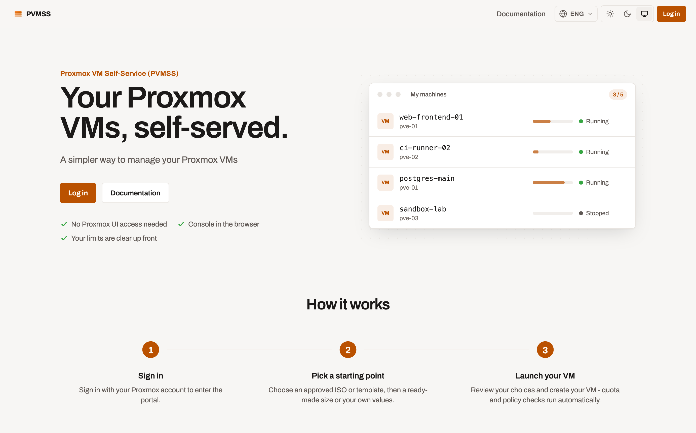
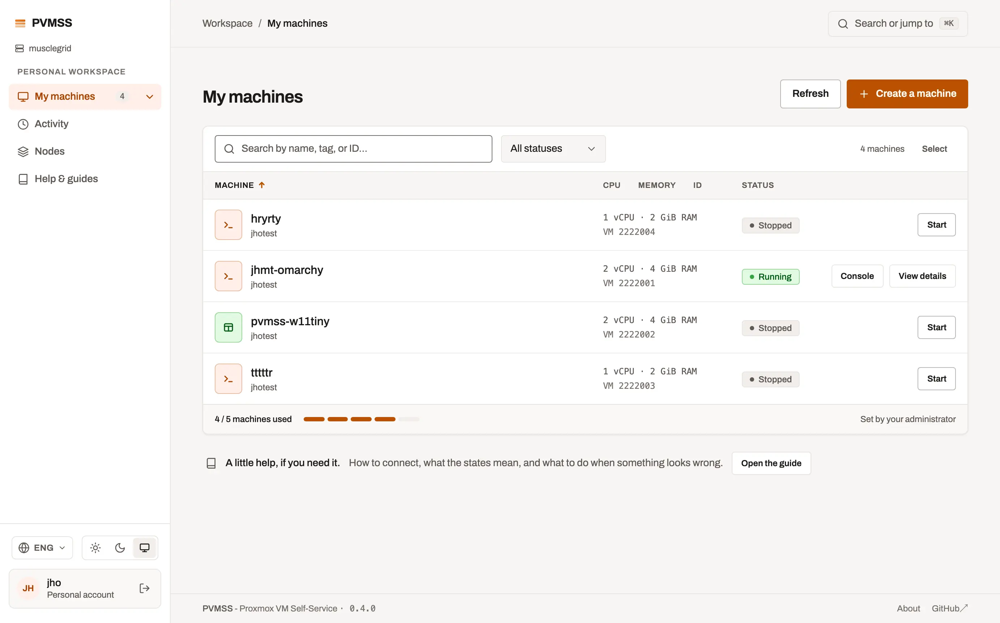

# Proxmox VM Self-Service (PVMSS)

[](https://github.com/julienhmmt/pvmss/actions/workflows/lint.yml) [](https://github.com/julienhmmt/pvmss/actions/workflows/v0.4.yml)

> A lightweight, self-service portal for Proxmox VE that lets users create, operate, and troubleshoot virtual machines without exposing the Proxmox UI.

French version: [README.fr.md](README.fr.md)

<!-- markdownlint-disable MD033 -->
<picture>
  <source media="(prefers-color-scheme: dark)" srcset="img/pvmss-v0.4.0-index-eng-dark.png">
  
</picture>
<!-- markdownlint-enable MD033 -->

## Table of contents

1. [What it does](#what-it-does)
2. [Quick start](#quick-start)
3. [Proxmox setup](#proxmox-setup)
4. [First sign-in](#first-sign-in)
5. [VM templates carry the sign-in](#vm-templates-carry-the-sign-in)
6. [Going further](#going-further)
7. [Coming from v0.3](#coming-from-v03)
8. [Limitations](#limitations)
9. [License](#license)

## What it does

PVMSS is a web application (Go REST API + SvelteKit SPA) that drives every VM action through the Proxmox API and keeps its own configuration in SQLite. The interface is available in English, French, German, and Italian.

**For users**

- Sign in with Proxmox credentials and see **My VMs**: live status, bulk power actions, a console in every row.
- **Create a VM** from an approved ISO or a Proxmox template, with hardware profiles, auto-placement, multi-NIC, UEFI/TPM and curated tags.
- **Operate a VM**: power actions, disks, NICs, CPU/RAM, snapshots (manual and scheduled), duplication, leases, metrics and activity log.
- **Consoles**: noVNC and serial in the browser, proxied through PVMSS.

**For administrators**

- Several Proxmox clusters, an approved catalog (nodes, storages, ISOs, templates, bridges), hardware profiles and tags.
- Self-service users (Proxmox user + pool + ACL in one step), quotas, per-node capacity caps, quota requests.
- Node-to-node migration, dashboard, audit log, database export/import, in-app documentation editor.

The complete, route-by-route inventory lives in [docs/FEATURES.md](docs/FEATURES.md).

<!-- markdownlint-disable MD033 -->
<picture>
  <source media="(prefers-color-scheme: dark)" srcset="img/pvmss-v0.4.0-my-vms-eng-dark.webp">
  
</picture>
<!-- markdownlint-enable MD033 -->

## Quick start

Requirements: Docker, a Proxmox VE 9.x cluster and an API token (see [Proxmox setup](#proxmox-setup)).

1. Create `docker-compose.yml`:

   ```yaml
   services:
     pvmss:
       image: jhmmt/pvmss:0.4.0
       container_name: pvmss
       restart: unless-stopped
       ports:
         - "50000:50000/tcp"
       environment:
         PVMSS_CLUSTER_SOURCE: "proxmox"
         PROXMOX_URL: "https://ip-or-name:8006/api2/json"
         PROXMOX_API_TOKEN_NAME: "pvmss-svc@pve!pvmss-service-token"
         PROXMOX_API_TOKEN_VALUE: "aaaaaaaa-0000-44aa-1111-aaaaaaaaaaa"
         # Generate with: openssl rand -hex 32
         SESSION_SECRET: "replace-with-output-of-openssl-rand-hex-32"
         # Bcrypt hash of the bootstrap "admin" password; every "$" doubled for Compose
         ADMIN_PASSWORD_HASH: "<bcrypt hash - generate your own>"
         # Plain HTTP with no TLS in front: drop the Secure cookie flag (keep it on behind HTTPS)
         PVMSS_COOKIE_SECURE: "false"
         PVMSS_PORT: "50000"
         LOG_LEVEL: "info"
         LOG_FORMAT: "console"
         LOG_OUTPUT: "stdout"
         TZ: "Europe/Paris"
       volumes:
         - pvmss_data:/data

   volumes:
     pvmss_data: {}
   ```

2. Generate your own admin hash and replace the example one:

   ```bash
   htpasswd -bnBC 10 "" "StrongPassword" | tr -d ':\n'
   ```

3. Start it and browse to <http://localhost:50000>:

   ```bash
   docker compose up -d
   ```

Prefer `docker run`? Pass the same variables with `-e` and mount `-v pvmss_data:/data`. On Kubernetes, use the Helm chart in [`helm/`](helm/) (`helm install pvmss ./helm -n pvmss --create-namespace -f my-values.yaml`); [`helm/values.yaml`](helm/values.yaml) documents every value.

Persist the whole `/data` directory, not only `pvmss.db`: SQLite runs in WAL mode and keeps `-wal`/`-shm` files next to it. Every variable is described in [docs/configuration.md](docs/configuration.md).

## Proxmox setup

Only Proxmox VE 9.x and newer are supported. PVMSS needs a service account with an API token, and optionally a human administrator. As _root_ on a Proxmox node:

```bash
# PVMSS_Service: role, user and API token used by PVMSS itself
pveum roleadd PVMSS_Service -privs "Sys.Audit VM.Audit VM.Allocate VM.PowerMgmt VM.Console VM.Config.CDROM VM.Config.CPU VM.Config.HWType VM.Config.Memory VM.Config.Disk VM.Config.Network VM.Config.Options VM.Config.Cloudinit VM.Snapshot VM.Snapshot.Rollback VM.Clone VM.Migrate VM.GuestAgent.Audit Datastore.Audit Datastore.AllocateSpace Pool.Allocate Pool.Audit User.Modify Permissions.Modify Realm.AllocateUser SDN.Audit SDN.Use"

pveum useradd pvmss-svc@pve -comment "PVMSS service account" -enable 1

pveum user token add pvmss-svc@pve pvmss-service-token --privsep 0

pveum aclmod / -user pvmss-svc@pve -role PVMSS_Service -propagate 1

# PVMSSUser: role PVMSS grants each self-service user on their pool
pveum roleadd PVMSSUser -privs "VM.Allocate VM.Audit VM.Console VM.Config.Disk VM.Config.Network VM.Config.CPU VM.Config.Memory VM.Config.Options VM.Config.Cloudinit VM.Config.CDROM VM.PowerMgmt VM.Snapshot VM.Snapshot.Rollback Datastore.AllocateSpace Datastore.Audit SDN.Use"

# PVMSS_Admin: optional human administrator signing in with Proxmox credentials
pveum roleadd PVMSS_Admin -privs "Sys.Audit VM.Audit VM.PowerMgmt VM.Console VM.Config.CPU VM.Config.Memory VM.Config.Disk VM.Config.Network VM.Config.HWType VM.GuestAgent.Audit VM.Migrate VM.Config.CDROM VM.Config.Options VM.Config.Cloudinit Datastore.Audit Datastore.AllocateSpace Pool.Allocate Pool.Audit User.Modify Permissions.Modify Realm.AllocateUser SDN.Audit Group.Allocate"

pveum useradd pvmss-admin1@pve -comment "PVMSS administrator <name>" -password "strong_password" -enable 1

pveum aclmod / -user pvmss-admin1@pve -role PVMSS_Admin -propagate 1
```

Put the token name (`pvmss-svc@pve!pvmss-service-token`) and its secret in `PROXMOX_API_TOKEN_NAME` / `PROXMOX_API_TOKEN_VALUE`. The same commands, with explanations, are in the in-app page `/docs/proxmox-permissions`.

## First sign-in

On `/login`, either:

- turn on the **Local administrator** toggle and sign in as `admin` with the password behind `ADMIN_PASSWORD_HASH`. This account works even when no cluster is reachable, and it alone creates further local administrators (**Admin > Settings > Accounts**);
- or sign in with a Proxmox account holding `Permissions.Modify` on `/` (the `Administrator` or `PVMSS_Admin` role; the built-in `PVEAdmin` role lacks it), realm `pve` or `pam`.

Then, from the Admin area: approve nodes, storages, ISOs, templates and bridges, create hardware profiles, and create your first self-service user. Password recovery and account rules: [docs/configuration.md](docs/configuration.md).

## VM templates carry the sign-in

PVMSS adds no SSH key and no password to the VMs it creates (cloud-init authoring was removed, see [docs/cloud-init.md](docs/cloud-init.md)). A clone keeps exactly what its Proxmox template carries, so build every template you approve with the sign-in users need:

1. In the template's **Cloud-Init** tab in Proxmox, set the user and an SSH public key or a password (or bake an account into the image).
2. Install and enable `qemu-guest-agent`, so VMs report their address.
3. Convert it (`qm template <vmid>`) and approve it in **Admin > VM templates**.

ISO installs are unaffected: users create their own account during installation, from the browser console.

## Going further

| Topic                                                        | Where                                          |
| ------------------------------------------------------------ | ---------------------------------------------- |
| All environment variables, admin accounts, password recovery | [docs/configuration.md](docs/configuration.md) |
| Logs, JSON and SIEM syslog, Prometheus metrics, tracing      | [docs/observability.md](docs/observability.md) |
| HTTPS, mutual TLS, reverse proxies, VM console WebSockets    | [docs/tls.md](docs/tls.md)                     |
| Every feature, route by route                                | [docs/FEATURES.md](docs/FEATURES.md)           |
| Development stack, tests, contributing                       | [CONTRIBUTING.md](CONTRIBUTING.md)             |

**Upgrades within v0.4.x**: pull the new image tag and restart; configuration stays in the database. The in-app documentation pages are seeded once and never overwritten, so your edits survive upgrades.

**Behind a reverse proxy**: the VM consoles are WebSockets. Each hop must forward the WebSocket upgrade and keep idle connections open for a whole console session. A black console or a `1006` error means the WebSocket never reached PVMSS; recipes for HAProxy, nginx, Caddy, Traefik and Kubernetes are in [docs/tls.md](docs/tls.md).

## Coming from v0.3

There is no migration: v0.4 is a rewrite and imports nothing from v0.3. Deploy it as a new installation on a new database, then configure it again from the Admin UI. Your VMs stay in Proxmox.

- New required variables: `PVMSS_PORT`, `PVMSS_CLUSTER_SOURCE`, `LOG_LEVEL` (lowercase only), `LOG_FORMAT`, `LOG_OUTPUT`.
- `PROXMOX_URL` and `PROXMOX_API_TOKEN_*` only seed the first cluster; afterwards **Admin > Clusters** owns them.
- Removed variables are listed in [docs/configuration.md](docs/configuration.md).
- Pools and Proxmox users from an earlier install still sign in, but **Admin > PVMSS users** only lists the ones this database created.

## Limitations

- Only Proxmox VE 9.x and newer are supported.
- Security hardening is ongoing; no formal penetration test yet.
- No HA-managed VMs, no cross-cluster migration; SDN and firewall rules stay in Proxmox.
- SSO goes through a Proxmox OpenID realm set per cluster (see `docs/oidc.md`); logout is local only.

Feedback and contributions are welcome through issues or pull requests. Next versions: <https://github.com/julienhmmt/pvmss/projects?query=is%3Aopen>.

## License

PVMSS by Julien HOMMET is licensed under **GNU AGPL v3**. See <https://www.gnu.org/licenses/agpl-3.0.en.html>.
